<!-- ═══════════════════════════════════════════════════════════════ -->
<!-- TZAYADET · PROFILE README                                      -->
<!-- Original visual assets and My Way section preserved.          -->
<!-- ═══════════════════════════════════════════════════════════════ -->

<p align="center">
  
</p>

<p align="center">
  
</p>

<p align="center">
  <a href="https://github.com/tzayadet"></a>
  <a href="https://www.linkedin.com/in/mjmal/"></a>
  <a href="https://www.codewars.com/users/tzayadet"></a>
  <a href="https://github.com/tzayadet/CTF"></a>
</p>

<p align="center">
  
</p>

## 『 ABOUT 』

<table>
  <tr>
    <td width="78%" valign="middle">
      <p><b>CYBERSECURITY · SYSTEMS · SECURITY GOVERNANCE</b></p>
      <p>Cybersecurity professional with a background in systems administration and security governance, currently focused on developing further in offensive security and cyber intelligence. Key interests include penetration testing, Red Team, security testing, Threat Intelligence and OSINT.</p>
      <p>I use Python, scripting and practical development to build tools, automate tasks and explore security problems. My wider background in psychology and human resources adds a human-factors perspective to risk, awareness and technical recruitment.</p>
    </td>
    <td width="22%" align="center" valign="middle">
      
    </td>
  </tr>
</table>

<p align="center">
  
  
  
  
</p>

---

## 『 PROJECT PORTFOLIO 』

<p align="center"><sub>TWO COMPLEMENTARY TRACKS · SOFTWARE DEVELOPMENT & CYBERSECURITY</sub></p>

<p align="center">
  <a href="#software-development"></a>
  <a href="#cybersecurity"></a>
</p>

---

<a id="software-development"></a>

## 『 01 · SOFTWARE DEVELOPMENT 』

<p align="center"><sub>WEB APPLICATIONS · DESKTOP SOFTWARE · PYTHON · JAVA · JAVASCRIPT · AUTOMATION</sub></p>

Projects focused on building applications, interfaces, utilities and automation workflows. Security-related products are classified by their primary purpose in the Cybersecurity section.

### WEB APPLICATIONS & INTERACTIVE PRODUCTS

<table>
<tr>
<td width="50%" valign="top">
<a href="https://tzayadet.github.io/visor/">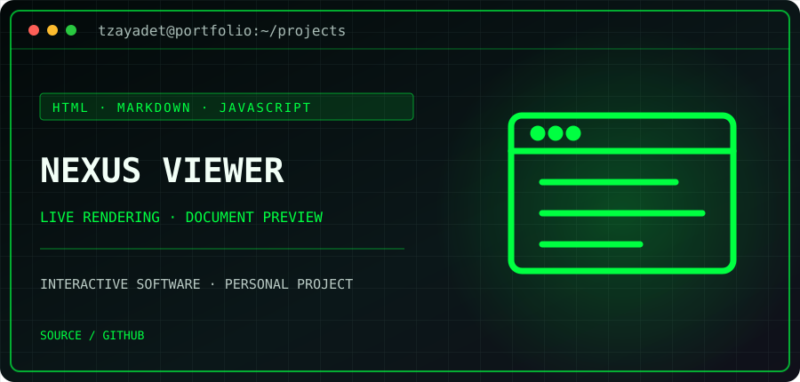</a>
<p align="center"><b>NEXUS VIEWER</b><br/><sub>Browser-based workspace for writing and previewing HTML, Markdown and JavaScript, with a live rendering panel and console.</sub><br/><a href="https://tzayadet.github.io/visor/">LIVE DEMO</a> · <a href="https://github.com/tzayadet/visor">SOURCE</a></p>
</td>
<td width="50%" valign="top">
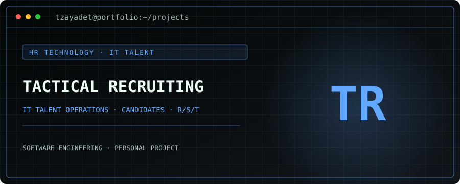
<p align="center"><b>TACTICAL RECRUITING · ALVATROSS</b><br/><sub>IT talent-management application with candidate and vacancy records, technical-stack matching, CV handling, recruitment workflows and R/S/T evaluation scoring. Includes a browser demo and a Python/SQLite application.</sub><br/><sub>PRIVATE REPOSITORY · DEMO NOT PUBLIC</sub></p>
</td>
</tr>
<tr>
<td width="50%" valign="top">
<a href="https://tzayadet.github.io/PassGen/">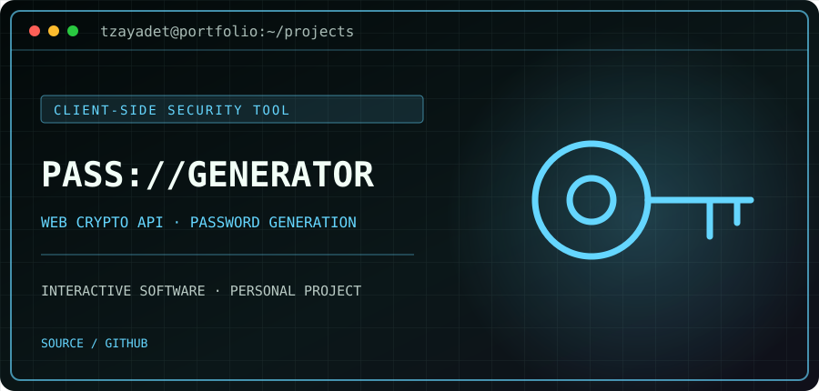</a>
<p align="center"><b>PASS://GENERATOR</b><br/><sub>Client-side password generator using the Web Crypto API. Configurable length, character pools, ambiguity exclusions, bulk generation, clipboard copy and TXT export.</sub><br/><a href="https://tzayadet.github.io/PassGen/">LIVE DEMO</a> · <a href="https://github.com/tzayadet/PassGen">SOURCE</a></p>
</td>
<td width="50%" valign="top">
<a href="https://tzayadet.github.io/CV_Cyberplayer/">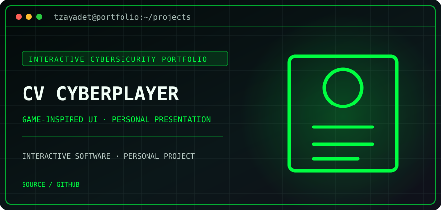</a>
<p align="center"><b>CV CYBERPLAYER</b><br/><sub>Interactive cybersecurity portfolio and CV with a custom terminal interface, animated elements, audio controls and an embedded operations-style monitor.</sub><br/><a href="https://tzayadet.github.io/CV_Cyberplayer/">LIVE DEMO</a> · <a href="https://github.com/tzayadet/CV_Cyberplayer">SOURCE</a></p>
</td>
</tr>
<tr>
<td width="50%" valign="top">
<a href="https://tzayadet.github.io/HTML2PDF/">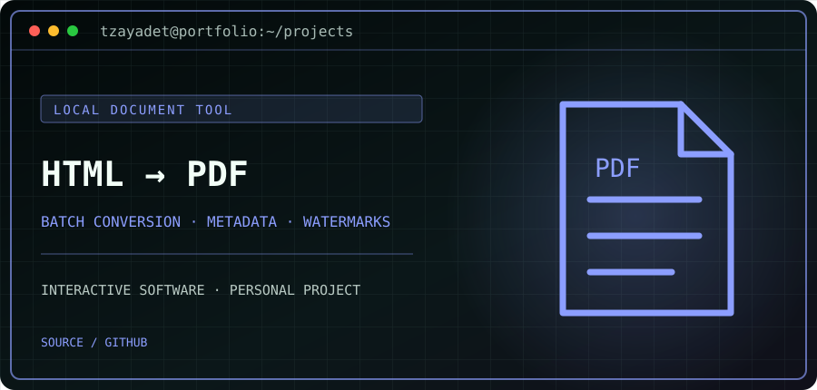</a>
<p align="center"><b>HTML → PDF · BATCH CONVERTER</b><br/><sub>Browser-based local document converter. Supports HTML, Markdown, files and URL queues, batch processing, continuous-page layouts, metadata removal, watermarks, merging and selectable/searchable PDF output modes.</sub><br/><a href="https://tzayadet.github.io/HTML2PDF/">LIVE DEMO</a> · <a href="https://github.com/tzayadet/HTML2PDF">SOURCE</a></p>
</td>
<td width="50%" valign="top">
<a href="https://tzayadet.github.io/Pet-Gen/">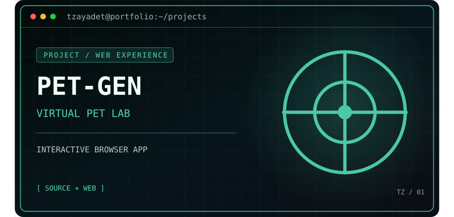</a>
<p align="center"><b>PET WIDGET GENERATOR</b><br/><sub>Configurable virtual companion with care mechanics, progression, achievements and exportable HTML widget.</sub><br/><a href="https://tzayadet.github.io/Pet-Gen/">LIVE DEMO</a> · <a href="https://github.com/tzayadet/Pet-Gen">SOURCE</a></p>
</td>
</tr>
<tr>
<td width="50%" valign="top">
<a href="https://tzayadet.github.io/RPaaS-Affirmative-Response-Engine/">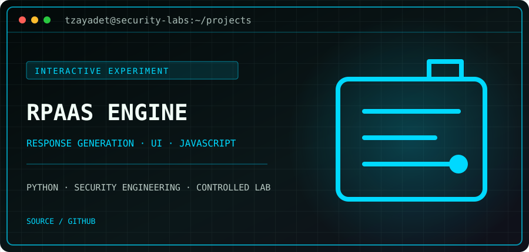</a>
<p align="center"><b>RPaaS · AFFIRMATIVE RESPONSE ENGINE</b><br/><sub>Small browser experiment for generating procedural responses with a terminal-style typewriter effect.</sub><br/><a href="https://tzayadet.github.io/RPaaS-Affirmative-Response-Engine/">LIVE DEMO</a> · <a href="https://github.com/tzayadet/RPaaS-Affirmative-Response-Engine">SOURCE</a></p>
</td>
<td width="50%" valign="top">
<a href="https://github.com/tzayadet/AutoClick_Navegador">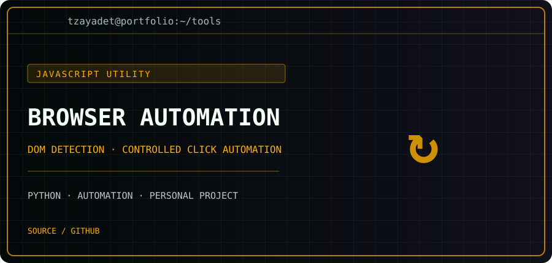</a>
<p align="center"><b>BROWSER AUTOMATION UTILITIES</b><br/><sub>Small JavaScript utilities for automating repetitive page interactions and expanding paginated content.</sub><br/><a href="https://github.com/tzayadet/AutoClick_Navegador">SOURCE</a></p>
</td>
</tr>
<tr>
<td width="50%" valign="top">
<a href="https://tzayadet.github.io/Cyber-Recruit/">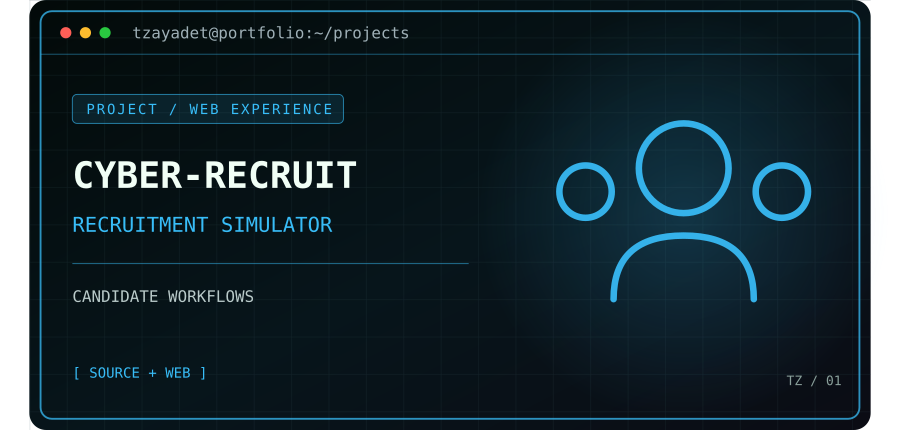</a>
<p align="center"><b>CYBER-RECRUIT</b><br/><sub>Recruitment workflow simulator for technical profiles and candidate assessment.</sub><br/><a href="https://tzayadet.github.io/Cyber-Recruit/">LIVE DEMO</a> · <a href="https://github.com/tzayadet/Cyber-Recruit">SOURCE</a></p>
</td>
<td width="50%" valign="top">
<a href="https://tzayadet.github.io/Profile_Analysis/">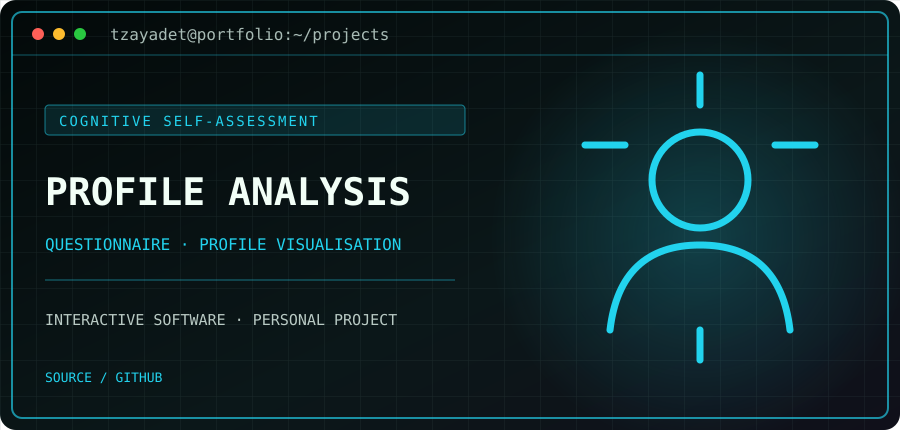</a>
<p align="center"><b>PROFILE ANALYSIS</b><br/><sub>Interactive questionnaire and multidimensional profile visualisation.</sub><br/><a href="https://tzayadet.github.io/Profile_Analysis/">LIVE DEMO</a> · <a href="https://github.com/tzayadet/Profile_Analysis">SOURCE</a></p>
</td>
</tr>
<tr>
<td width="50%" valign="top">
<a href="https://tzayadet.github.io/DnD-Arquetipo/">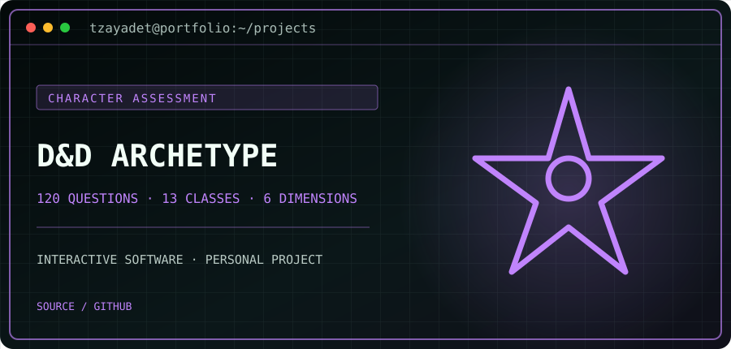</a>
<p align="center"><b>D&D ARCHETYPE</b><br/><sub>Interactive character assessment with 120 questions, 13 classes and six dimensions.</sub><br/><a href="https://tzayadet.github.io/DnD-Arquetipo/">LIVE DEMO</a> · <a href="https://github.com/tzayadet/DnD-Arquetipo">SOURCE</a></p>
</td>
<td width="50%" valign="top">
<a href="https://tzayadet.github.io/Cipher-Veil/">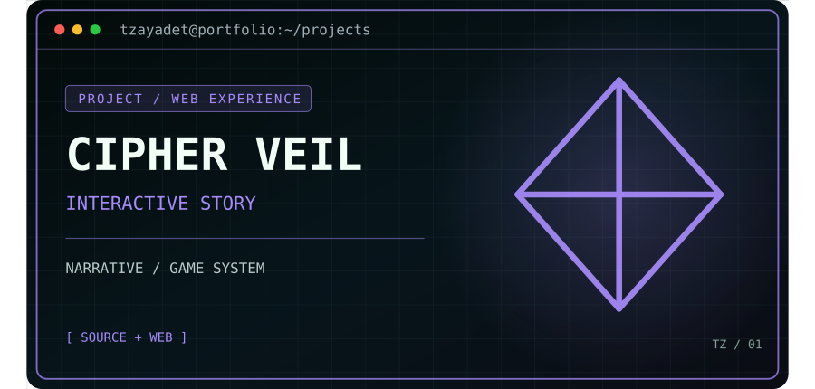</a>
<p align="center"><b>CIPHER VEIL</b><br/><sub>Interactive narrative and browser-based visual experience.</sub><br/><a href="https://tzayadet.github.io/Cipher-Veil/">LIVE DEMO</a> · <a href="https://github.com/tzayadet/Cipher-Veil">SOURCE</a></p>
</td>
</tr>
<tr>
<td width="50%" valign="top">
<a href="https://tzayadet.github.io/SoldierOps/">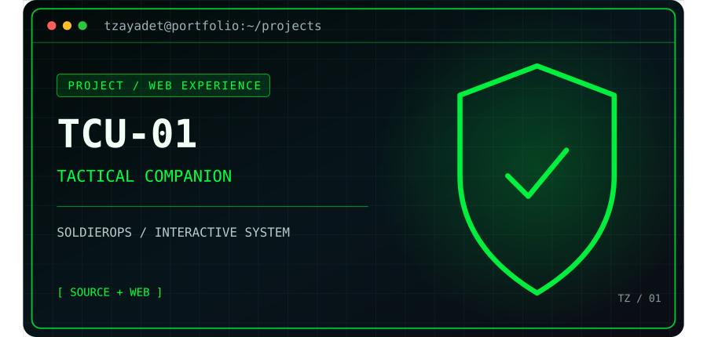</a>
<p align="center"><b>SOLDIEROPS</b><br/><sub>Interactive tactical companion with a terminal-inspired interface.</sub><br/><a href="https://tzayadet.github.io/SoldierOps/">LIVE DEMO</a> · <a href="https://github.com/tzayadet/SoldierOps">SOURCE</a></p>
</td>
<td width="50%" valign="top">
<a href="https://tzayadet.github.io/C4ISR-Gotchi/">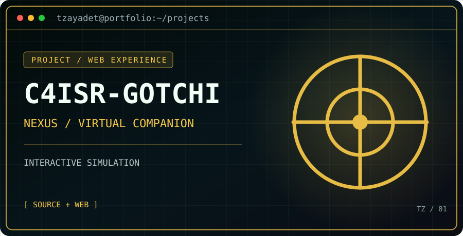</a>
<p align="center"><b>C4ISR-GOTCHI</b><br/><sub>Virtual-pet concept with tactical simulation and interactive browser mechanics.</sub><br/><a href="https://tzayadet.github.io/C4ISR-Gotchi/">LIVE DEMO</a> · <a href="https://github.com/tzayadet/C4ISR-Gotchi">SOURCE</a></p>
</td>
</tr>
<tr>
<td width="50%" valign="top">
<a href="https://tzayadet.github.io/Lobito/">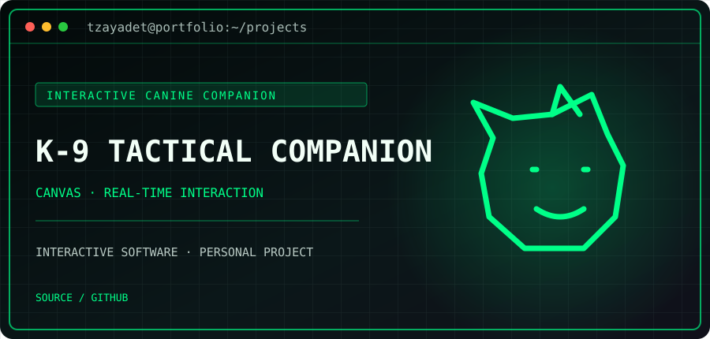</a>
<p align="center"><b>K-9 TACTICAL COMPANION · LOBITO</b><br/><sub>Interactive canine companion built with Canvas and real-time browser interaction.</sub><br/><a href="https://tzayadet.github.io/Lobito/">LIVE DEMO</a> · <a href="https://github.com/tzayadet/Lobito">SOURCE</a></p>
</td>
<td width="50%" valign="top">
<a href="https://tzayadet.github.io/GameTracker/">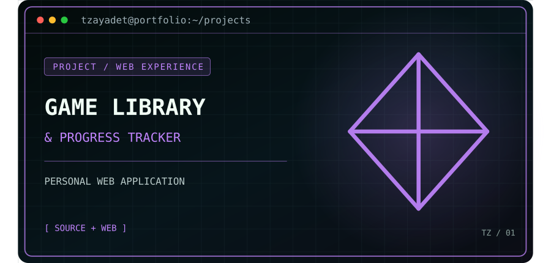</a>
<p align="center"><b>GAMETRACKER</b><br/><sub>Personal game-library and progress-tracking application.</sub><br/><a href="https://tzayadet.github.io/GameTracker/">FRONTEND PREVIEW</a> · <a href="https://github.com/tzayadet/GameTracker">SOURCE</a></p>
</td>
</tr>
<tr>
<td width="50%" valign="top">
<a href="https://tzayadet.github.io/Digimon/">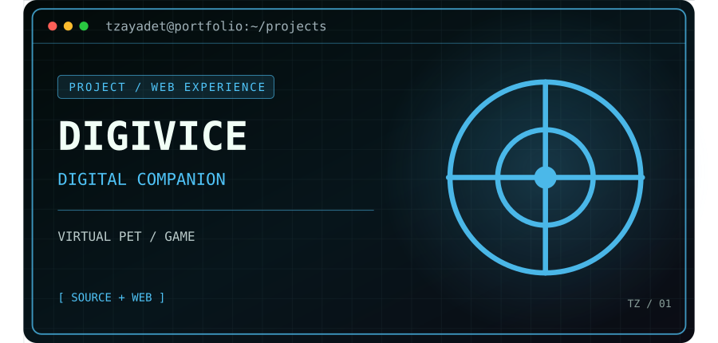</a>
<p align="center"><b>DIGIVICE</b><br/><sub>Interactive digital-pet interface inspired by handheld virtual-pet devices.</sub><br/><a href="https://tzayadet.github.io/Digimon/">LIVE DEMO</a> · <a href="https://github.com/tzayadet/Digimon">SOURCE</a></p>
</td>
<td width="50%" valign="top">
<a href="https://github.com/tzayadet/Cybersend-WhatsCron">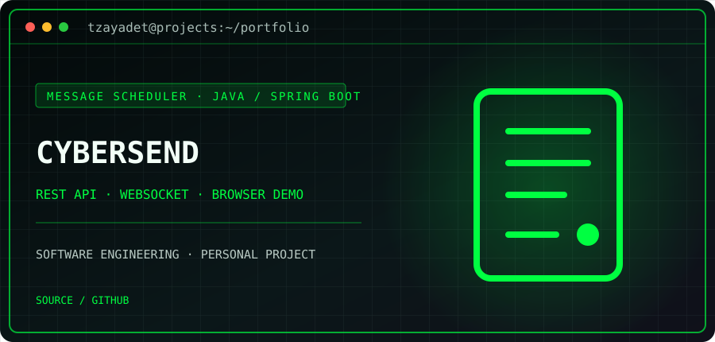</a>
<p align="center"><b>CYBERSEND · WHATSCRON</b><br/><sub>Java/Spring Boot scheduling backend with REST API and WebSocket updates.</sub><br/><a href="https://github.com/tzayadet/Cybersend-WhatsCron">SOURCE</a></p>
</td>
</tr>
</table>

### DESKTOP SOFTWARE & AUTOMATION

<table>
<tr>
<td width="50%" valign="top">
<a href="https://github.com/tzayadet/matrix_downloader">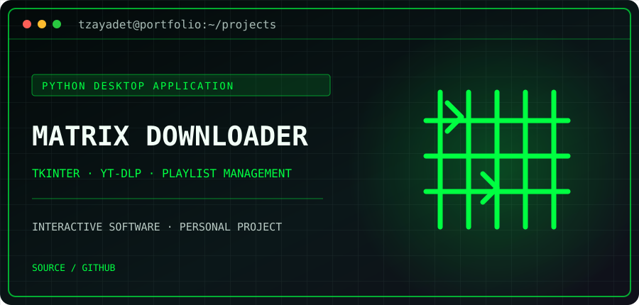</a>
<p align="center"><b>MATRIX DOWNLOADER</b><br/><sub>Python/Tkinter desktop application for managing audio and video downloads from individual URLs and playlists. Supports item selection, output formats, quality settings and a portable Windows build workflow.</sub><br/><a href="https://github.com/tzayadet/matrix_downloader">SOURCE</a></p>
</td>
<td width="50%" valign="top">
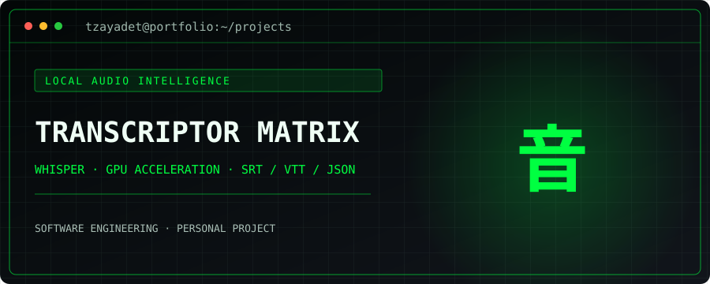
<p align="center"><b>TRANSCRIPTOR MATRIX</b><br/><sub>Local audio/video transcription desktop application powered by OpenAI Whisper. Runs on the user's machine without per-minute API fees; supports transcription or English translation and TXT, SRT, VTT and JSON exports.</sub><br/><sub>PRIVATE REPOSITORY</sub></p>
</td>
</tr>
<tr>
<td width="50%" valign="top">
<a href="https://github.com/tzayadet/AnalizadorArchivos">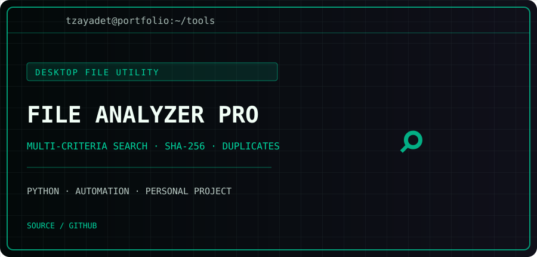</a>
<p align="center"><b>FILE ANALYZER PRO</b><br/><sub>Python desktop utility for advanced file search and filtering, content matching, SHA-256 duplicate detection, disk-usage analysis, error reporting and CSV export.</sub><br/><a href="https://github.com/tzayadet/AnalizadorArchivos">SOURCE</a></p>
</td>
<td width="50%" valign="top">

<p align="center"><b>INTEGRITY CHECKER</b><br/><sub>Python desktop application for validating file and video integrity through structural container checks, full FFmpeg decoding, MD5/SHA-1/SHA-256 hashes and expected-size comparison. Exports CSV and TXT reports.</sub><br/><sub>PRIVATE REPOSITORY</sub></p>
</td>
</tr>
<tr>
<td width="50%" valign="top">
<a href="https://github.com/tzayadet/GameTranslator">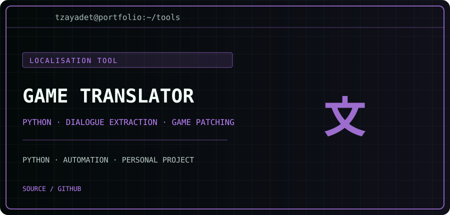</a>
<p align="center"><b>GAME TRANSLATOR</b><br/><sub>Python utility for extracting and translating game dialogue files, applying language patches and maintaining automatic backups and restore support.</sub><br/><a href="https://github.com/tzayadet/GameTranslator">SOURCE</a></p>
</td>
<td width="50%" valign="top"></td>
</tr>
</table>

### DEVELOPMENT LEARNING & PRACTICE

- [Development](https://github.com/tzayadet/Desarrollo) · General software-development workspace.
- [Python Projects](https://github.com/tzayadet/Python) · Python scripts, utilities and experiments.
- [Java Projects](https://github.com/tzayadet/Java) · Java programming and application-development exercises.
- [SQL Practice](https://github.com/tzayadet/SQL-Basics) · SQL fundamentals and query practice.
- [Codewars](https://github.com/tzayadet/Codewars) · Programming kata solutions.
- [Bash / Linux](https://github.com/tzayadet/Bash-Linux) · Shell scripting and Linux practice.
- [Web Audio & Interactive Experiments](https://github.com/tzayadet/JavaScript) · Browser-based audio synthesis, interfaces and JavaScript experiments.

---

<a id="cybersecurity"></a>

## 『 02 · CYBERSECURITY 』

<p align="center"><sub>OFFENSIVE SECURITY · OSINT · SECURITY ENGINEERING · GRC · THREAT INTELLIGENCE</sub></p>

Projects focused on security assessment, intelligence, defensive engineering, compliance and controlled security research.

### SECURITY OPERATIONS, GRC & COMPLIANCE

<table>
<tr>
<td width="50%" valign="top">
<a href="https://github.com/tzayadet/HoneyRecruitingCyber">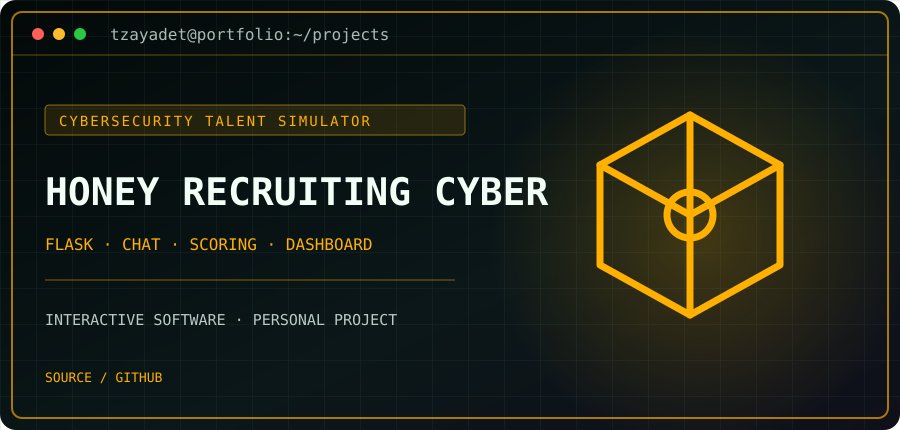</a>
<p align="center"><b>HONEY RECRUITING CYBER</b><br/><sub>Cybersecurity recruitment honeypot built with Flask. Simulates a technical forum where conversational bots assess security knowledge through keyword analysis, skill-level scoring and interaction analytics.</sub><br/><a href="https://tzayadet.github.io/HoneyRecruitingCyber/">PROJECT OVERVIEW</a> · <a href="https://github.com/tzayadet/HoneyRecruitingCyber">SOURCE · FLASK APPLICATION</a></p>
</td>
<td width="50%" valign="top">
<a href="https://tzayadet.github.io/CyberOps-Monitor/">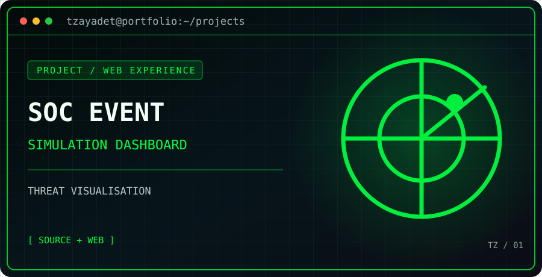</a>
<p align="center"><b>CYBEROPS MONITOR</b><br/><sub>SOC-style threat-intelligence and security-monitoring simulator with IOC scoring, dashboard visualisation and Java/Spring components.</sub><br/><a href="https://tzayadet.github.io/CyberOps-Monitor/">LIVE DEMO</a> · <a href="https://github.com/tzayadet/CyberOps-Monitor">SOURCE</a></p>
</td>
</tr>
<tr>
<td width="50%" valign="top">
<a href="https://tzayadet.github.io/ENS_Blackout/">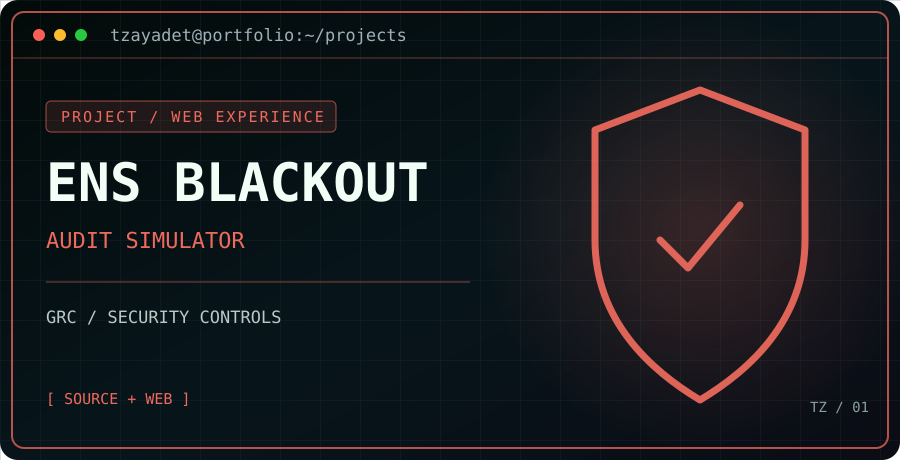</a>
<p align="center"><b>ENS BLACKOUT</b><br/><sub>Interactive ENS security-control audit and learning environment.</sub><br/><a href="https://tzayadet.github.io/ENS_Blackout/">LIVE DEMO</a> · <a href="https://github.com/tzayadet/ENS_Blackout">SOURCE</a></p>
</td>
<td width="50%" valign="top">
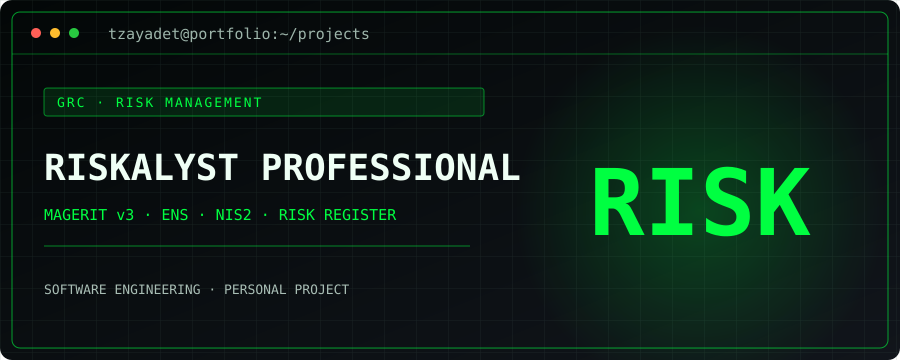
<p align="center"><b>RISKALYST PROFESSIONAL</b><br/><sub>GRC and risk-management workspace aligned with MAGERIT v3, ENS and NIS2. Includes asset inventory, threat catalogue, risk maps, residual-risk assessment, safeguards and executive reporting.</sub><br/><sub>PRIVATE REPOSITORY · DEMO NOT PUBLIC</sub></p>
</td>
</tr>
<tr>
<td width="50%" valign="top">
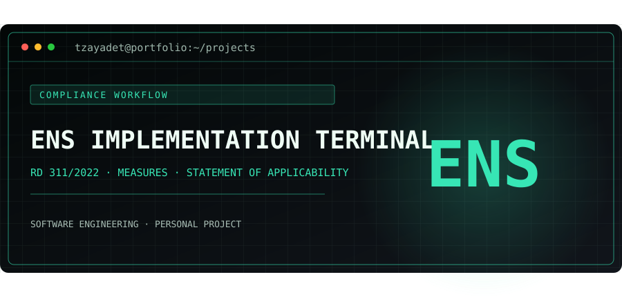
<p align="center"><b>ENS IMPLEMENTATION TERMINAL</b><br/><sub>Practical ENS implementation workflow covering scope, categorisation, risk analysis, measures, Statement of Applicability and compliance follow-up. Local browser storage with backup/export support.</sub><br/><sub>PRIVATE REPOSITORY · DEMO NOT PUBLIC</sub></p>
</td>
<td width="50%" valign="top">
<a href="https://github.com/tzayadet/rosetta_multinorma"></a>
<p align="center"><b>ROSETTA MULTINORMA</b><br/><sub>Multinorm compliance mapping for ENS, ISO/IEC 27001, NIS2 and ISO/IEC 42001. Fork of the original project by heindall92.</sub><br/><a href="https://heindall92.github.io/rosetta_multinorma/">LIVE DEMO · UPSTREAM</a> · <a href="https://github.com/tzayadet/rosetta_multinorma">FORK</a></p>
</td>
</tr>
</table>

### OSINT, FORENSICS & SECURITY ENGINEERING

<table>
<tr>
<td width="50%" valign="top">
<a href="https://github.com/tzayadet/OSINT-Asset-Extractor">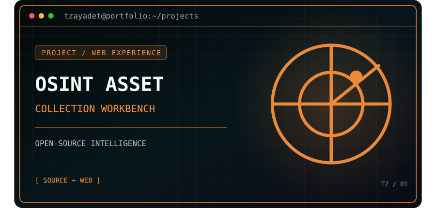</a>
<p align="center"><b>OSINT ASSET EXTRACTOR</b><br/><sub>Python utility for collecting publicly accessible website assets with file-type filtering and controlled download options.</sub><br/><a href="https://github.com/tzayadet/OSINT-Asset-Extractor">SOURCE</a></p>
</td>
<td width="50%" valign="top">
<a href="https://github.com/tzayadet/OSINT-Correlator"></a>
<p align="center"><b>OSINT CORRELATOR</b><br/><sub>DNS enrichment and correlation for domain and IP investigations.</sub><br/><a href="https://github.com/tzayadet/OSINT-Correlator">SOURCE</a></p>
</td>
</tr>
<tr>
<td width="50%" valign="top">
<a href="https://github.com/tzayadet/Escaner-IaC">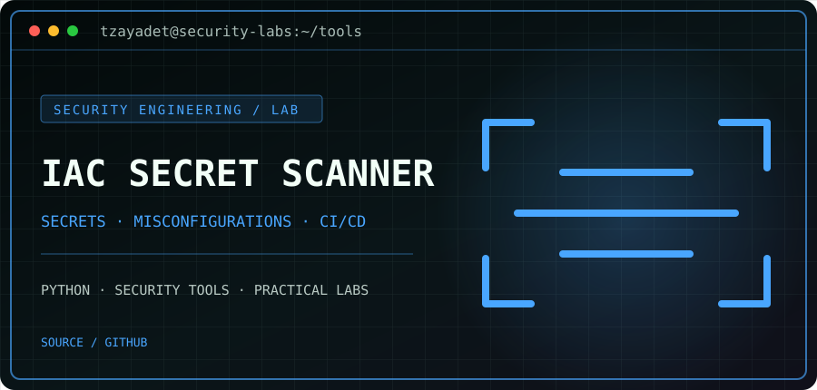</a>
<p align="center"><b>IaC SCANNER</b><br/><sub>Static checks for exposed secrets and misconfigurations in Terraform, YAML and JSON files.</sub><br/><a href="https://github.com/tzayadet/Escaner-IaC">SOURCE</a></p>
</td>
<td width="50%" valign="top">
<a href="https://github.com/tzayadet/Toolkit-Forense">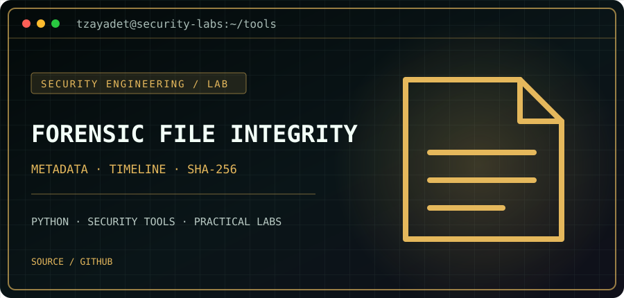</a>
<p align="center"><b>FORENSIC TOOLKIT</b><br/><sub>Forensic utilities for metadata extraction, timeline creation and SHA-256 hashing.</sub><br/><a href="https://github.com/tzayadet/Toolkit-Forense">SOURCE</a></p>
</td>
</tr>
<tr>
<td width="50%" valign="top">
<a href="https://github.com/tzayadet/01-Honeypot-SSH">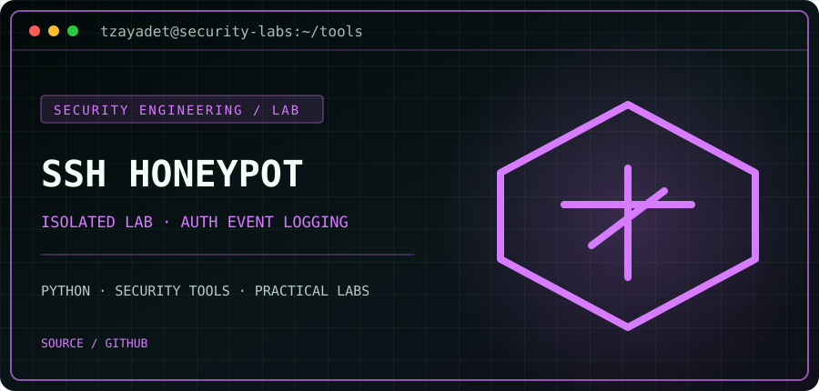</a>
<p align="center"><b>SSH HONEYPOT</b><br/><sub>Isolated SSH honeypot lab for observing authentication attempts and recording events.</sub><br/><a href="https://github.com/tzayadet/01-Honeypot-SSH">SOURCE</a></p>
</td>
<td width="50%" valign="top">
<a href="https://github.com/tzayadet/C2-Light">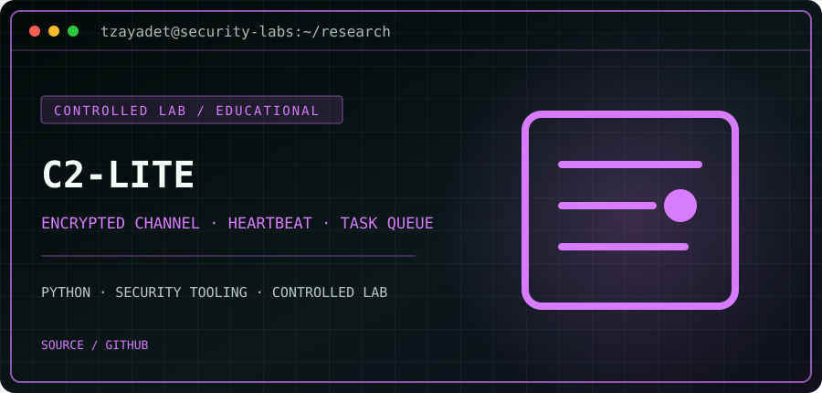</a>
<p align="center"><b>C2-LITE</b><br/><sub>Educational command-and-control framework for controlled lab environments.</sub><br/><a href="https://github.com/tzayadet/C2-Light">SOURCE</a></p>
</td>
</tr>
<tr>
<td width="50%" valign="top">
<a href="https://github.com/tzayadet/Pipeline-de-Logs">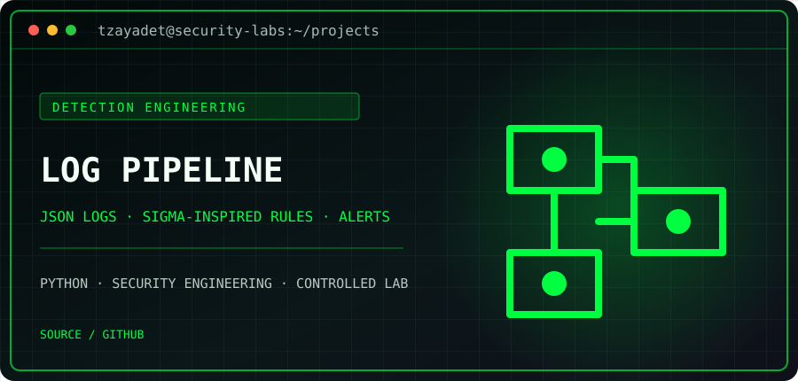</a>
<p align="center"><b>LOG PIPELINE</b><br/><sub>Python log-processing and detection pipeline with JSON parsing and Sigma-inspired rules.</sub><br/><a href="https://github.com/tzayadet/Pipeline-de-Logs">SOURCE</a></p>
</td>
<td width="50%" valign="top"></td>
</tr>
</table>

### RESEARCH & COMMUNITY REPOSITORIES

<p align="center"><sub>Forks and external reference projects are identified separately from original implementations.</sub></p>

- [Malware Research Hub](https://github.com/tzayadet/Malware-Research-Hub) · Forked research catalogue and local Flask interface. Handle samples only in isolated lab environments.
- [Claude OSINT](https://github.com/tzayadet/Claude-OSINT) · Fork of an OSINT skills collection. Original author: [elementalsouls](https://github.com/elementalsouls).
- [Cybersecurity Projects](https://github.com/tzayadet/Cybersecurity-Projects) · Forked learning roadmap and project collection. Original author: [CarterPerez-dev](https://github.com/CarterPerez-dev).
- [PayloadsAllTheThings](https://github.com/tzayadet/PayloadsAllTheThings) · Fork of the reference repository by [swisskyrepo](https://github.com/swisskyrepo).

### TRAINING, CTF & ACADEMIC WORK

- [CTF Write-ups & Labs](https://github.com/tzayadet/CTF) · Practical notes and challenge write-ups.
- [Cybersecurity Master's Project](https://github.com/tzayadet/TFM-Ciberseguridad) · Academic lab documentation and security tooling.
- [Development projects](https://github.com/tzayadet/Desarrollo) · Software development practice and project archive.
- [Learning Journey](https://github.com/tzayadet/Learning-Journey) · Structured learning notes and exercises.
- [Python Projects](https://github.com/tzayadet/Python) · Python exercises, utilities and experiments.
- [Java Projects](https://github.com/tzayadet/Java) · Java exercises and application-development practice.
- [SQL Practice](https://github.com/tzayadet/SQL-Basics) · SQL fundamentals and query exercises.
- [Codewars](https://github.com/tzayadet/Codewars) · Programming kata solutions.

---

<p align="center"><sub>HYBRID PROJECTS: Honey Recruiting Cyber combines software development with cybersecurity recruitment research; CyberOps Monitor combines application engineering with security-monitoring concepts.</sub></p>

## 『 TECHNICAL STACK 』

<p align="center"><sub>SEPARATE SPECIALISMS · SHARED ENGINEERING FOUNDATION</sub></p>

<table>
  <tr>
    <td width="33%" valign="top">
      <p align="center"><b>CYBERSECURITY · OFFENSIVE</b></p>
      <p align="center"></p>
      <p align="center">
        
        
        
        
        
        
        
        
        
        
        
      </p>
    </td>
    <td width="33%" valign="top">
      <p align="center"><b>CYBERSECURITY · NETWORK & CLOUD</b></p>
      <p align="center">
        
        
        
        
        
        
        
        
        
        
      </p>
    </td>
    <td width="33%" valign="top">
      <p align="center"><b>CYBERSECURITY · GRC & INTELLIGENCE</b></p>
      <p align="center">
        
        
        
        
        
        
        
      </p>
    </td>
  </tr>
</table>

<p align="center"><b>SOFTWARE DEVELOPMENT · PROGRAMMING & AUTOMATION</b></p>
<p align="center">
  
  
  
  
  
  
  
  
  
  
  
  
  
  
  
</p>

<p align="center">
  
  &nbsp;&nbsp;
  
  &nbsp;&nbsp;
  
  &nbsp;&nbsp;
  
</p>

---

## 『 CTF · LABS · PRACTICE 』

<table>
  <tr>
    <td width="28%"><b>PLATFORMS</b></td>
    <td>TryHackMe · Hack The Box · VulnHub · OverTheWire · PicoCTF</td>
  </tr>
  <tr>
    <td><b>LAB PRACTICE</b></td>
    <td>Linux environments · enumeration · web security · network analysis</td>
  </tr>
  <tr>
    <td><b>CODING</b></td>
    <td>Python · SQL · Bash · PowerShell · Codewars · automation</td>
  </tr>
  <tr>
    <td><b>WRITE-UPS</b></td>
    <td><a href="https://github.com/tzayadet/CTF">CTF notes and practical write-ups</a></td>
  </tr>
</table>

<p align="center">
  <a href="https://tryhackme.com/p/tzayadet"></a>
  <a href="https://app.hackthebox.com/profile/tzayadet"></a>
  <a href="https://github.com/tzayadet/CTF"></a>
</p>

<p align="center">
  
</p>

---

## 『 GITHUB ACTIVITY 』

<p align="center">
  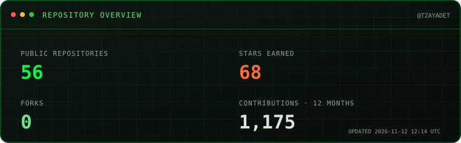
</p>

<table>
  <tr>
    <td width="50%" align="center" valign="top">
      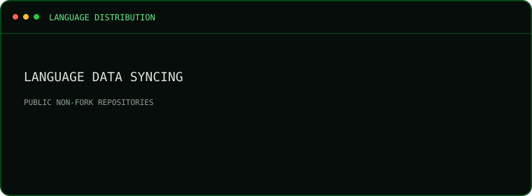
    </td>
    <td width="50%" align="center" valign="top">
      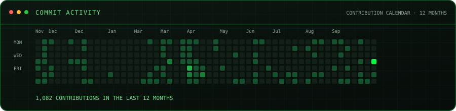
    </td>
  </tr>
</table>

<p align="center">
  
  
  
</p>
---

## 『 MY WAY 』

<p align="center">
  
</p>

<p align="center">▲▼▲▼▲▼▲▼▲▼▲▼▲▼▲▼▲▼▲▼▲▼▲▼▲▼▲▼▲▼▲▼</p>

<table>
  <tr>
    <td width="40%" valign="middle">
      <p align="center"></p>
    </td>
    <td width="60%" valign="middle">
      <p><b>𝘾𝙐𝙍𝙄𝙊𝙎𝙄𝙏𝙔</b><br/><i>asking better questions,<br/>and understanding how systems behave.</i></p>
      <p><b>𝙀𝙑𝙄𝘿𝙀𝙉𝘾𝙀</b><br/><i>testing assumptions,<br/>and documenting what the evidence shows.</i></p>
      <p><b>𝘿𝙄𝙎𝘾𝙄𝙋𝙇𝙄𝙉𝙀</b><br/><i>consistent practice,<br/>clear thinking and continuous improvement.</i></p>
      <p><b>𝙏𝙀𝘼𝙈𝙒𝙊𝙍𝙆</b><br/><i>sharing knowledge,<br/>communicating clearly and taking responsibility.</i></p>
    </td>
  </tr>
</table>

<p align="center">
  
</p>

<details>
  <summary><b>PROFILE SNAPSHOT · PYTHON</b></summary>

```python
from dataclasses import dataclass


@dataclass(frozen=True)
class CybersecurityProfile:
    """A concise snapshot of my technical focus and professional background."""

    handle: str = "tzayadet"
    focus_areas: tuple[str, ...] = (
        "Penetration testing and offensive security",
        "Red Team methodologies and security testing",
        "Threat intelligence, cyber intelligence and OSINT",
        "Python automation and security tooling",
        "Systems, networks, cloud security and GRC",
    )
    background: tuple[str, ...] = (
        "Systems administration",
        "Cybersecurity and governance",
        "Psychology and human factors",
    )
    approach: str = "Evidence-driven, methodical and collaborative"

    def summary(self) -> dict[str, object]:
        return {
            "profile": self.handle,
            "focus": self.focus_areas,
            "background": self.background,
            "approach": self.approach,
        }


profile = CybersecurityProfile()
print(profile.summary())
```

</details>

---

<p align="center"></p>

<p align="center">
  
</p>

<p align="center">
  
</p>

<p align="center">
  
</p>

<p align="center">
  
</p>

<!-- Original artwork retained and redistributed: n1.gif in ABOUT, kalilinux.gif in SECURITY & OFFENSIVE. -->
<!-- Original Snake artwork, restored as a small footer element. -->
<p align="center">
  <a href="https://youtu.be/ez43--JPdwI?si=gZ4zkBIWzUhXiDGG"></a>
</p>

<!-- No unfinished bootcamp, invented operational status, or generic player labels. -->